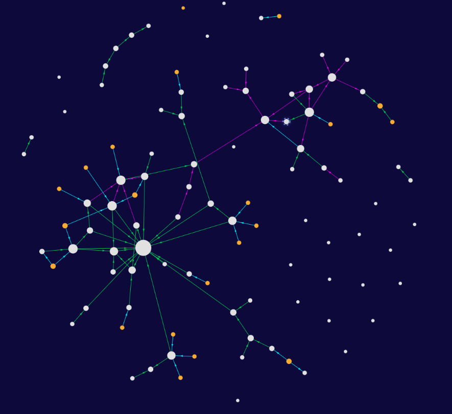
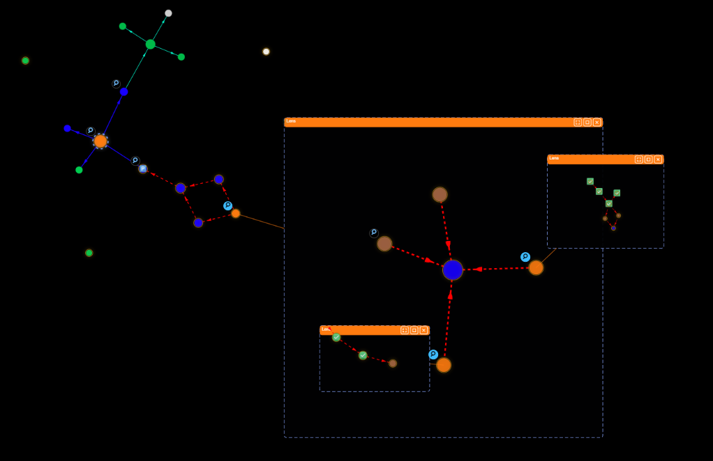
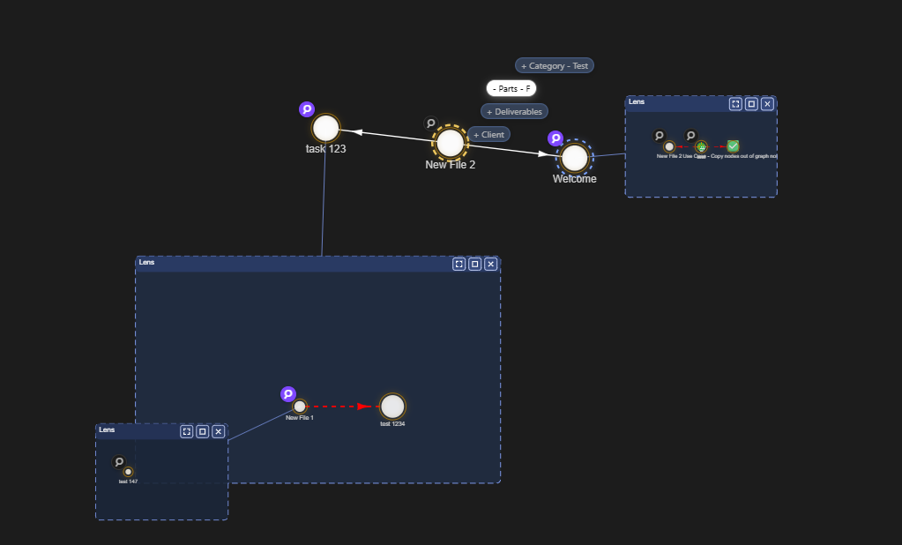

# NosyGraph

Build and explore structured, expandable graphs from your Obsidian notes.

Version **0.3.1**. See the [release notes](docs/releases/0.3.1.md)
and [release/verification guide](docs/releases/0.3.1-release-guide.md).

NosyGraph is an Obsidian plugin for building interactive, property-driven graph views from Markdown notes. It reads relationships from note frontmatter, LinkType notes, group notes, graph notes, graph-capable notes, and Obsidian Bases views, then renders them as an explorable canvas graph with expandable links, embedded graph lenses, typed edges, grouping, and persistent graph-note state.

**Beta warning:** This plugin is currently beta software. Use it first in a copied vault or with reliable backups enabled. Earlier development builds had a critical bug where an open graph note could sometimes be emptied when Obsidian reloaded while the graph view was active. This has not been seen recently, and safeguards have been added to block unsafe empty graph-state writes, but graph notes should still be treated as important data and backed up.

## Screenshots



### Expandable Graph Lenses



### Nested Lenses And Graph Navigation



## Features

### Graph Notes

- Create persistent graph notes that store runtime graph state in an `o3graph` code block.
- Add root nodes through graph-note frontmatter.
- Persist visible node instances, node positions, pinned state, viewport, badge expansion state, embedded graph lenses, and UI state.
- Migrate older graph-note JSON layouts to the current state layout.
- Clear graph runtime data and rebuild it from graph-note frontmatter.
- Configure graph-note property keys in plugin settings to fit existing vault conventions.
- Choose a Markdown template under **Graph note template → Template file** to create new graph notes through Templater. Leave it empty to use the built-in graph note without Templater. Template output is preserved; a missing graph identifier is added, while a conflicting identifier opens in Markdown for correction.

### Graph-Capable Notes

- Open regular notes as graph views when they contain configured root-node properties.
- Use plugin-level default `rootNodeProperties`, `activeGroups`, and `visibleLinkTypes` for graph-capable notes without writing defaults into note frontmatter.
- Override defaults per note through frontmatter.
- Explicitly render graph transclusions only when using a graph-view subpath such as `![[Some Note#graphview]]`.

### Graph Tabs

- Run **Open Graph Tab**, then use the upper-right mode button to switch between the graph and Obsidian’s Markdown editor in the same tab.
- Markdown supports normal note editing, properties, and reading mode. With one selected node, it shows that note; when the selection is empty, it shows the graph source note. Select multiple notes to show the **Selected notes** list. Entries use their full paths, and opening an entry leaves the graph root and selection in place.
- Drag the divider beside **Selected notes** to resize the list. NosyGraph saves the width for each graph note and restores it when you reopen that graph.
- Use the chain button to link to a specific open tab, rather than to a note path. Linked Graph Tabs follow only that tab’s note and graph selection, including when it is inactive; selecting nodes in other tabs does not redirect them. If the source closes, use the chain button to relink or return to **Automatic**.
- Automatic mode follows the graph pane you last used, including rendered graph embeds, and keeps the normal active-note following rules. Each Graph Tab saves its own mode and source binding with the workspace.

### LinkTypes

- Define LinkType notes that describe how relationship properties should be read and rendered.
- Expand LinkType badges to add linked notes to the graph.
- Support LinkTypes with one property or multiple equivalent properties.
- Define `linkType: lens` LinkTypes with multiple read properties and an optional
  `writeProperty`, keeping each viewport independent. A Lens uses its linked targets as members. Ordinary lines and springs require a separately enabled ordinary LinkType, which can read the same property.
- Support outgoing, incoming, and bidirectional link discovery.
- Support LinkTypes that create duplicate nodes where duplicate visual contexts are required.
- Configure LinkType colors, badge colors, line colors, line thickness, arrow direction, link force, link distance, and duplicate behavior.
- Use `visibleLinkTypes` to show typed edges only between nodes already visible in the graph.
- Configure visible and discovered link styles as normal or dashed.
- Set `linkTypeIcon` to an Obsidian/Lucide icon name, emoji, or short text. Default icons distinguish Lens, Force Based, Direction Based, and Parent badges; see [badge icon examples](#linktype-badge-icons).

### Relationship Editing

- Add relationships by dragging a node onto another node's LinkType badge.
- Alt-click a LinkType badge to search for or create a single note, or paste note links to preview a batch. The preview shows full paths, skipped links, and the write property. Use **Enter** or **Add** to submit the eligible notes, **Remove** or **Clear** to edit the batch, or **Escape** to cancel before writing.
- Batch paste supports graph Copy/Cut links, wiki and Markdown note links, and links copied from property lists. Incoming badges write a link to the clicked note in each pasted note's configured property. Outgoing and both-direction badges write in the clicked note. A batch skips relationships already present in an equivalent property.
- **Also add to graph membership** is On by default and saves immediately from the badge input or plugin settings. It applies to search, note creation, and pasted batches. The modal shows the property that already lists the clicked note and asks you to pick one when several match.
- Inside a Lens LinkType, membership belongs to the enclosing Lens source note. If a badge link saves and membership fails, retry membership from the same modal.
- Mutate source note YAML as the source of truth, then refresh graph state from the changed note.
- Apply a Templater template to selected graph nodes with **Apply template to
  selected nodes** when the Templater plugin is enabled.
- Respect Obsidian link format settings where possible.
- Configure whether dropped LinkTypes auto-expand after the relationship is added.
- Render unresolved or missing-file links as translucent graph nodes until the target file exists.

### Lenses And Embedded Graphs

- Expand graph-note nodes and graph-capable notes into graph lenses.
- Open nested lenses from nodes inside lenses.
- A Lens LinkType badge opens the notes linked under its configured read properties, without inserting the source node into the Lens. Lens membership keeps its viewport connector and does not create ordinary node-to-node edges or springs. Enable a separate Force Based or Direction Based LinkType when those edges are wanted.
- Move, resize, maximize, restore, close, and fit lens content.
- Pan and zoom inside a lens independently from the parent graph.
- Persist lens position, size, maximize state, and viewport state in graph notes.
- Keep lens interactions layer-aware so background lenses do not receive foreground cursor or resize behavior.
- Clip lens indicators and lens contents to the visible lens viewport.
- Preserve embedded graph state independently from the parent graph.

### Containers

- Use parent-type LinkTypes to render semantic parent containers instead of ordinary link lines.
- Keep child nodes inside parent containers.
- Support nested and overlapping containers.
- Repel containers and nodes on the same hierarchy where appropriate.
- Render container colors from LinkType or group configuration.

### Groups And Styling

- Define group notes that style matching nodes by frontmatter conditions.
- Apply group colors and icons to nodes.
- Allow overlapping groups, with group priority based on `activeGroups` order.
- Apply parent-graph groups to nodes inside embedded graphs and lenses.
- Live-refresh group styling when relevant note frontmatter changes.
- Configure active node indicator color, root node ring color, nearest visible linked node indicator, subnode opacity, icon opacity, and graph background color.

### Node Rendering

- Render default circular nodes.
- Render text or emoji node icons from a configured note property.
- Render image-based node icons, including PNG-style image files.
- Render group icons from group notes.
- Set node size globally, by number of connections, or per individual node.
- Keep selected node labels visible even above the normal text fade threshold.

### Interaction

- Click and shift-click to select nodes.
- Alt-drag to select multiple nodes.
- Drag selected nodes to reposition them.
- Drag pinned nodes to reposition them.
- Right-click nodes, containers, and graph objects for context actions.
- Open nodes with double click.
- Open nodes in a new tab from the context menu.
- Copy selected graph node links with `Ctrl+C` / `Cmd+C` when a graph view is focused.
- Cut selected nodes with **Cut node / Cut nodes** beside Copy in the context menu, `Ctrl+X` / `Cmd+X` on the focused canvas, or the **Cut selected graph nodes** command. Cut unlinks each selected instance from the properties that introduce it, including graph roots, classic and nested lenses, Lens LinkType viewports, and active property badge expansions. Incoming expansions remove the reverse reference while copying the selected note’s link. Body-link-only and filter-only nodes are skipped with an explanation. Editable fields retain native text cutting.
- Paste copied or cut links into note bodies, source frontmatter, or property widgets using the existing paste integration. Paste can be repeated. Cut publishes and registers the eligible links before removing references. A partial-failure notice identifies failed owner updates or runtime refreshes, and the clipboard retains the original eligible links for recovery.
- Cutting the last root leaves an empty property array and keeps the graph usable. Referenced note files, unrelated property values, and note bodies are preserved. Ambiguous compound property values are skipped.
- Select all nodes across the focused graph and its open lenses with `Ctrl+A` / `Cmd+A`. In Markdown mode, native editor shortcuts continue to act on text.
- Configure separate hotkeys for showing all LinkType badges and freezing the graph.
- Lock graph containers/lenses so dragging inside them pans the viewport instead of moving the object.

### Obsidian Bases Integration

- Connect a graph note to one or more Obsidian Bases views through `connected_base_filter`.
- Add notes returned by the linked Base view as filter/core graph nodes.
- Refresh graph nodes when supported Base filter results or relevant note properties change.

### Export

- Export the current graph view as a PNG image from Obsidian's command palette.
- Export the current viewport or fit exported bounds to graph content.
- Export with graph-note background, transparent background, or custom background.
- Save exports to a vault-relative path.
- Export canvas-rendered graph objects only. DOM overlays such as badges, pin buttons, lens buttons, hover UI, and context menus are intentionally excluded.

### Performance And Safety

- Reduce unnecessary graph recalculation by slowing frame cadence near rest and at rest.
- Configure near-rest and rest velocity thresholds per graph.
- Watch relevant files and properties instead of refreshing the whole vault whenever possible.
- Suppress watcher reloads during graph-document writes.
- Block unsafe graph-state writes that would overwrite populated graph data with empty snapshots.

## Basic Setup

Install the plugin into the `.obsidian/plugins/nosygraph/` folder inside an Obsidian vault.

The folder should contain:

```text
main.js
manifest.json
styles.css
```

For local development from source:

```bash
npm install
npm run build
```

## Privacy And Permissions

NosyGraph works locally inside Obsidian and does not make network requests.

The plugin may enumerate Markdown files in the vault to resolve graph roots, graph capable notes, incoming links, discovered link types, connected Base view results, and missing-file relationships. This is needed because graph membership can depend on links and frontmatter relationships across multiple notes.

Clipboard access is used for explicit Copy and Cut actions in the graph view and for text supplied by a paste event. The badge input reads pasted text when you paste into it. NosyGraph does not read clipboard content for background processing.

## Note Types

NosyGraph is built around Markdown notes with configurable frontmatter conventions. The property names below are the current defaults; many identifying and graph-note property keys can be changed in the plugin settings so the plugin can fit an existing vault.

### Graph Note

A graph note is a persistent graph view. It defines the graph's roots and active behavior in frontmatter, and stores runtime view state in an `o3graph` code block.

| Property | Values | Description |
| --- | --- | --- |
| `o3Graph` | `true` | Default graph-note identifier. Configure its property and value under Note identifiers in plugin settings. |
| `rootNodes` | List of wiki links | Notes that are added as core/root nodes. |
| `rootNodeProperties` | List of property names | Linked notes under these properties are resolved as root nodes. |
| `activeLinkTypes` | List of LinkType note links | LinkTypes shown as expandable badges on nodes. Expanding a badge can add linked nodes. |
| `activeOverlayLinkTypes` | List of LinkType note links | LinkTypes rendered as overlay relationships between already relevant/core nodes. |
| `visibleLinkTypes` | List of LinkType note links, keys, or properties | Shows typed edges only between nodes already visible in the graph. It does not add nodes. |
| `activeGroups` | List of group note links | Group rules that color or decorate matching nodes. Earlier entries have priority when group styling conflicts. |
| `activeFilters` | List | Unused legacy field. Use connected Base filters for filtering. |
| `connected_base_filter` | Wiki link to `.base#View`, or a list of links | Combines notes returned by all linked Bases views as filter/core nodes, deduplicated by note path. |
| `autoExpandDroppedLinkTypes` | `true` or `false` | Controls whether dropping a node onto a LinkType badge also expands/refreshes that badge after the YAML mutation. If missing, the plugin default applies. |
| `visibleLinkTypeLineStyle` | `dashed` or `normal` | Line style for edges generated by `visibleLinkTypes`, including plugin-default visible LinkTypes. |
| `discoveredLinkLineStyle` | `dashed` or `normal` | Line style for discovered/expanded LinkType edges. |
| `showNodeIcons` | `true` or `false` | Controls whether icon/image node rendering is enabled in this graph. |
| `graph_background_color` | CSS color | Canvas background color for this graph view, for example `"#F7AA34"`. |
| `graphForce_Gravity` | Number | Global gravity strength for the graph. |
| `graphForce_Repellent` | Number | Global node/container repulsion strength. |
| `graphNode_Size` | Number | Default rendered node size. |
| `graphNode_ConnectionSizeMultiplier` | Number | Optional size multiplier based on connection count. |
| `graphVelocity_NearRestThreshold` | Number | Velocity threshold below which the graph slows frame cadence. |
| `graphVelocity_RestThreshold` | Number | Velocity threshold below which the graph is treated as resting. |
| `graphText_FadeThreshold` | Number | Zoom threshold controlling label/title fade behavior. |
| `layoutId` | Layout identifier | Optional graph layout selector when multiple layouts are supported. |
| `graphContainer_Color` | CSS color | Embedded graph/lens container color. If missing, group color inheritance may apply. |
| `graphContainer_LinkForce` | Number | Force pulling embedded graph/lens nodes toward their local center. |
| `o3graph` code block | JSON | Runtime state: visible node instances, positions, pins, badges, lenses, viewport, and UI state. Relationship truth remains in regular notes. |

### Graph-Capable Note

A graph-capable note is a regular note that can be opened as a temporary graph view or expanded as a lens because it has linked notes under configured root-node properties. Plugin-level defaults can provide `rootNodeProperties`, `activeGroups`, and `visibleLinkTypes` without writing them into the note.

| Property | Values | Description |
| --- | --- | --- |
| `rootNodeProperties` | List of property names | Properties whose linked values become the graph-capable note's root nodes. |
| Any listed root property | Wiki link or list of wiki links | The linked notes shown when the graph-capable note is opened as a graph or lens. |
| `visibleLinkTypes` | List | Optional note-level override for typed visible edges between already included nodes. |
| `activeGroups` | List | Optional note-level override for group styling. |
| `o3graph` code block | JSON | Optional runtime state for graph-capable note views/lenses where supported. |

### LinkType Note / Link Note

A LinkType note defines a reusable relationship type. It tells NosyGraph which YAML property or properties to read, how relationships are discovered, and how the resulting edge or parent container is rendered.

| Property | Values | Description |
| --- | --- | --- |
| `o3LinkType` or configured type marker | `true`, or configured type value | Identifies the note as a LinkType note. Older/internal docs may also use a configurable `type: "[[link]]"` convention. |
| `key` | Text | User-facing label shown in badges, menus, and debug output. Falls back to the file name if missing. |
| `property` | Property name or list | YAML property/properties read for this LinkType. All listed properties are treated as equivalent read properties. The first listed property is the default write target for mutations. |
| `LinkDiscoveryDirection` | `outgoing`, `incoming`, or `both` | Controls whether expansion reads links from the current note, searches for notes that link to the current note, or both. |
| `direction` | `outgoing`, `incoming`, or `both` | Legacy arrow-direction fallback when PointerDirection is absent. Relationship reads use LinkDiscoveryDirection. |
| `linkType` | `Force Based` or `parent` | `Force Based` renders normal edges. `parent` renders a parent/container relationship. |
| `linkDuplicateNodes` | `true` or `false` | Allows duplicate visual node instances for semantic contexts when true. |
| `recursive` | `true` or `false` | Legacy field retained in saved definitions; currently does not change expansion behavior. |
| `linkForce` | Number | Link-specific force strength. |
| `linkDistance` | Number | Preferred link distance. |
| `PointerDirection` | `outgoing`, `incoming`, or `none` | Visual arrow direction. |
| `linkLineColor` | CSS/hex color | Edge and badge color. Badge label text is chosen for contrast. |
| `linkLineThickness` | Number | Edge thickness. Arrow size scales with thickness. |
| `color` | CSS/hex color | Fallback badge/link color when `linkLineColor` is missing. |

### Group Note

A group note defines a frontmatter condition and optional styling for matching nodes. Multiple active groups can overlap; the first matching group in `activeGroups` wins for conflicting styling such as color or icon.

| Property | Values | Description |
| --- | --- | --- |
| `o3Group` or configured type marker | `true`, or configured type value | Identifies the note as a group note. Older/internal docs may also use a configurable type value such as `[[graphGroup]]`. |
| `property` | Property name | Frontmatter property checked on candidate notes. |
| `operator` | `contains`, `equals`, or `exists` | Matching rule. |
| `value` | Text, wiki link, or list value | Target value for `contains` or `equals`. Not required for `exists`. |
| `color` | CSS/hex color | Node color, ring color, and inherited lens/container color where applicable. |
| `groupIcon` | Text, emoji, symbol, Excalidraw file reference, or supported image reference | Node body icon/image for matching nodes. Node color remains visible as a ring where possible. |

### Regular Node Note

Regular notes are the source of truth for graph relationships. Graph interactions should mutate these notes first; graph notes then reconcile their runtime state from Obsidian metadata and note frontmatter.

| Property | Values | Description |
| --- | --- | --- |
| Relationship properties | Wiki link or list of wiki links | Any property referenced by a LinkType, for example `parts`, `blocked_and`, `parents`, `project`, or `deliverables`. |
| Configured node icon property | Text, emoji, symbol, or image link/path | Optional node icon/image property. The default key may be `graphIcon`, but users can remap it, for example to `icon`. |
| Configured individual node size property | Number | Optional per-note node size override. |
| Group-relevant properties | Any | Properties such as `status`, `type`, `project`, or `context` that active group notes use for styling. |

### Base View

Obsidian Bases files are not NosyGraph note types, but graph notes can reference them through `connected_base_filter`.

| Property or reference | Values | Description |
| --- | --- | --- |
| `connected_base_filter` | `[[Some Base.base#View Name]]`, or a list of such links | Resolves every linked view and combines matching notes as filter/core graph nodes. |

For example, connect two views with:

```yaml
connected_base_filter:
  - "[[db test.base#Graphs]]"
  - "[[db task.base#waiting]]"
```

The graph shows the union of their results. A note matching both views appears
once. Multiple views of the same Base are supported, as is the original single
link syntax. Each view keeps its own global/view filters and result limit.
Edits to any connected Base refresh the graph. An unresolved or unsupported
connection produces a diagnostic while other connections continue to supply
their matching notes.

### Embedded Graph Note

An embedded graph note is a normal graph note used as a node inside another graph. Expanding its lens renders the embedded graph's current visible state while keeping the embedded graph's state owned by the embedded graph note.

| Property | Values | Description |
| --- | --- | --- |
| Graph note properties | See Graph Note | The embedded graph note keeps its own roots, visible state, lenses, and runtime JSON. |
| `graphContainer_Color` | CSS color | Optional embedded lens/container color. If empty, the parent graph's matching group color can be inherited. |
| `graphContainer_LinkForce` | Number | Local centering force for nodes inside the embedded graph/lens. |

## Graph Note Example

```yaml
---
o3Graph: true
rootNodes:
  - "[[Project A]]"
activeLinkTypes:
  - "[[System/LinkTypes/LinkType - Parts]]"
visibleLinkTypes:
  - "[[System/LinkTypes/LinkType - Blocked By]]"
activeGroups:
  - "[[System/Groups/Group - Tasks]]"
graph_background_color: "#101820"
graphForce_Gravity: 0.02
graphForce_Repellent: 500
graphNode_Size: 20
graphVelocity_NearRestThreshold: 0.08
graphVelocity_RestThreshold: 0.015
---
```

Graph notes store their runtime data in an `o3graph` code block. Regular relationship data should remain in the linked notes themselves; graph-note JSON is for view state and references.

## Graph-Capable Note Example

```yaml
---
rootNodeProperties:
  - parts
  - deliverables
parts:
  - "[[Part A]]"
  - "[[Part B]]"
visibleLinkTypes:
  - "[[LinkType - blocked_by]]"
---
```

A note with configured root-node properties can be opened directly in graph view even if it is not a persistent graph note.

## LinkType Example

```yaml
---
o3LinkType: true
key: Parts
property: parts
direction: outgoing
LinkDiscoveryDirection: outgoing
linkDuplicateNodes: false
linkForce: 0.5
linkDistance: 120
PointerDirection: outgoing
linkLineColor: "#00aaff"
linkLineThickness: 2
type:
  - "[[Graph Link]]"
---
```

LinkTypes can also list multiple properties:

```yaml
property:
  - parts
  - blocked_and
```

All listed properties are treated as equivalent read properties for that LinkType.

### LinkType badge icons

Set `linkTypeIcon` in the LinkType note to use a registered Obsidian/Lucide icon, an emoji or symbol, or short literal text. The setting works with every LinkType mode.

```yaml
o3LinkType: true
key: Project scope
linkType: lens
property:
  - parts
  - deliverables
writeProperty: parts
linkTypeIcon: telescope
```

You can replace `telescope` with `"🔭"`, `"★"`, or `"text:ABC"`. Quote symbol and text values in YAML, especially `"#"`, `"*"`, and `":"`. Registered names take precedence over bare symbols. Use `"text:x"` for a literal x or `"text:7"` for the numeral. Choose a short symbol or abbreviation because the badge clips text to the icon slot.

Missing, blank, or unrecognized values use the mode's default. Removing the property restores that default.

| LinkType mode | Default icon |
| --- | --- |
| Lens | `scan-search` |
| Force Based | `zap` |
| Direction Based | `arrow-right` |
| Parent | `git-branch` |

Map a custom frontmatter key under **LinkType property names → Badge icon** in plugin settings. Each definition uses its own glyph, including lenses that share a read property.

## Group Example

```yaml
---
o3Group: true
property: status
operator: contains
value: "[[ToDo]]"
color: "#F7AA34"
groupIcon: "tool"
---
```

Groups can overlap. If multiple active groups match a node, the first matching group in `activeGroups` wins for properties that conflict, such as color or icon.

## Known Risks

- This plugin writes to graph notes and relationship notes. Keep backups.
- The earlier graph-note-emptying bug has not appeared recently, but the risk is important enough to keep documented until the plugin has more broad testing.
- Embedded graphs and lenses are powerful but still newer functionality. Test complex nested lens workflows on copied vaults before relying on them.
- Very large graphs can still become visually dense or computationally heavy. Use filters, LinkTypes, groups, and lenses to keep graph views focused.

## Authorship And Development

NosyGraph was created by Jan Bergholz with the help of AI-assisted software development tools. Jan Bergholz managed and directed the development, defined the desired behavior, tested the plugin in real vault workflows, and made the product and design decisions. The implementation was developed iteratively with AI assistance.

The plugin manifest uses the id `nosygraph`, the name `NosyGraph`, and Jan Bergholz as author.

## Release Status

Current status: beta. Current release: [0.3.1](https://github.com/JanB987/NosyGraph/releases/tag/0.3.1). See the [release notes](docs/releases/0.3.1.md) and [verification guide](docs/releases/0.3.1-release-guide.md) for the changes and known limitations.

Release history is recorded in [CHANGELOG.md](CHANGELOG.md).

Before publishing to the official Obsidian Community Plugins directory, test at least:

- opening graph notes while Obsidian starts,
- reloading Obsidian with graph notes open,
- moving and renaming linked files,
- graph note migration,
- relationship edits through badges and input fields,
- embedded and nested lenses,
- connected Bases filters,
- large graph export,
- fresh-vault installation.

## License

NosyGraph is released under the MIT License. See `LICENSE` for the full license text.

### Graph note templates

In NosyGraph settings, choose a Markdown file under **Graph note template** to use it with **Create new graph note**. The picker includes the entire vault; the file does not need to be in Templater's template folder. Install and enable a compatible Templater plugin for a selected template. Clear the selection to use NosyGraph's built-in graph note without Templater. The new note is created in the active note's folder, or in the vault root when no note is active.

The template supplies the complete note, and Templater commands (including prompts, rename, and move) run before the graph opens. NosyGraph adds the configured graph identifier if it is absent. A matching property is preserved; if the property conflicts, the note opens in Markdown so you can fix the template or graph identifier setting. A missing template or Templater does not fall back to built-in content.
